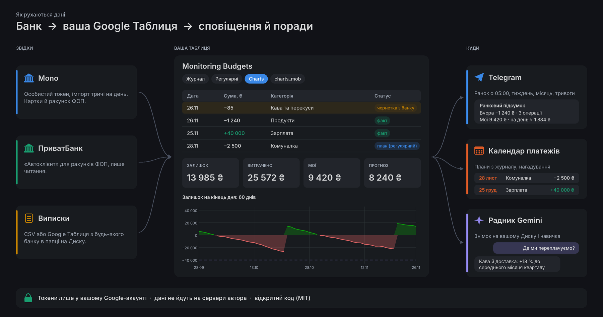
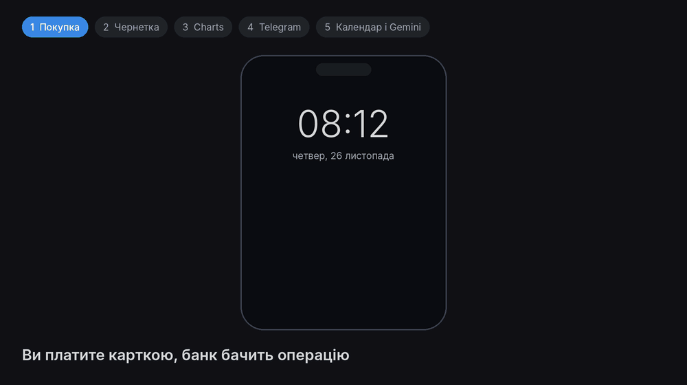
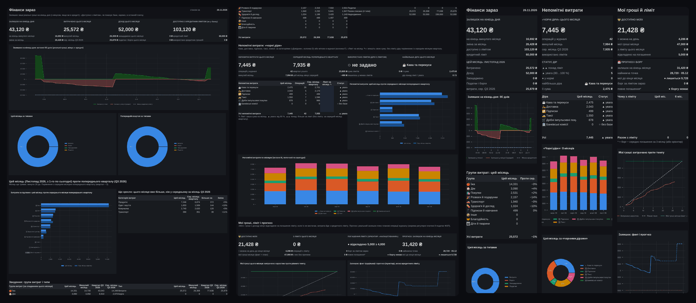

# Monitoring Budgets

Шаблон Google Таблиць для обліку сімейного бюджету і ФОП: журнал операцій, план і факт по місяцях, баланс по днях, «мої гроші» окремо від кредитного ліміту, «чорні діри» (непомітні витрати) і причини, чому взято з ліміту. Сім'я до 5 учасників, ФОП 1, 2 і 3 групи, борги й розстрочки, грейс Mono. Імпорт з Mono, ПриватБанку («Автоклієнт» для ФОП) і виписок CSV, Telegram-бот, нічні копії, календар платежів, радник на Gemini. Кожен модуль вмикається окремо. Код відкритий (ліцензія MIT), українською.

> Статус: версія 0.5.9, бета-тест. **Зробити копію**: посилання з'явиться тут після бета-тесту · [Як користуватися](docs/HOWTO.md) · [Що нового](CHANGELOG.md) · [Приватність](PRIVACY.md) · [❤️ Підтримати](https://send.monobank.ua/jar/6ChdYHjkd9)







*Усі цифри вигадані. «Charts» (дві частини, для комп'ютера) і «charts_mob» (для телефона) тут відмальовано поза Google Таблицями, тож там графіки виглядають трохи інакше.*

## Що всередині

На виду лише п'ять вкладок, як в особистій таблиці автора: «⚡ Швидке підключення», «Журнал», «Регулярні», «Charts», «charts_mob». Решта працює схованою (показати: модуль «🗂 Усі аркуші» в «🚀 Підключення», крок 5; на телефоні також через список аркушів).

| Аркуш | Що там |
|---|---|
| ⚡ Швидке підключення | на виду п'ять коротких рядків: що відкрити й що написати ШІ; під ними згорнуто стан таблиці й покрокову інструкцію для ШІ: напишіть Gemini в таблиці (чи іншому ШІ) «Прочитай аркуш «⚡ Швидке підключення» і налаштуй зі мною таблицю», і він проведе сам (регулярні, бюджети, борги, «Мої правила»); банк і Telegram: панель «🚀 Підключення» |
| Журнал | шапка: «мої», картка, три найгірші бюджети зі смужкою, наступний місяць, грейс, «Писати у рядок № … ↓»; нижче операції: дата, сума (повернення за покупку: мінус у категорії покупки), категорія, статус; формули рахують тип, «мої» після операції, з моїх / з ліміту |
| Регулярні | угорі плитки як у «Charts»: 💰 собі й інвестиції (% доходу), 🔁 скільки підключено, 💵 що лишається з доходу, 📅 цей місяць, ⏭ 30 днів з графіком, 💳 борги (з модулем); нижче оренда, підписки, зарплата: рядок на платіж (сума, день, щомісяця / щокварталу / щороку); стають планами в журналі, факт закриває план сам. Уже є 21 приклад з «ні» (Netflix, бензин, оренда, страховка, зарплата, кредит, розстрочка, борги…): поправте свій і поставте «так» |
| Charts | **дашборд у темному стилі (як Grafana)**: «Фінанси зараз» (залишок, витрачено, дохід, доступно з лімітом), залишок за 60 днів, типи цього місяця й кварталу, цей місяць проти середнього місяця попереднього кварталу (групи, «що зросло»), зведення груп і типів, «чорні діри» з вашими лімітами, мої гроші й прогноз, з ліміту, борг і причини |
| charts_mob | те саме для телефона: три вузькі стовпчики (фінанси зараз, непомітні витрати, мої гроші й ліміт), гортайте вбік |

Сховані (поки модуль «🗂 Усі аркуші»: ні; «ФОП» лише з модулем; «Борги» на виду, поки увімкнено модуль «🤝 Борги й розстрочки»):

| Аркуш | Що там |
|---|---|
| Місяці | категорії й підсумки × 12 місяців обраного року: план, факт, різниця; мої гроші, картка, причини, непомітні |
| Дні | баланс по днях від початку минулого місяця до кінця наступного: картка, борг за лімітом, «мої», прогноз |
| Довідник | категорії (тип, група, «чорна діра», план на місяць, чий бюджет), список «чорних дір», причини з ліміту |
| Налаштування | старт обліку «моїх грошей», день, з якого дохід іде в наступний місяць, орієнтир погашення, вид картки, ставка комісії, сім'я, радник |
| ФОП | ставки (рядок на рік), ФОП у сім'ї, податки по кварталах, строки, ліміт доходу групи (модуль) |
| Борги | хто кому винен, покупки частинами й розстрочки (вид, назва в банку, прогрес «▰▰▱▱ 3 з 25», «Закрито»), платіж на місяць, сплачено й залишок; ліміти Mono з перевіркою; платежі стають планами в журналі (модуль, на виду з ним) |
| Головне | головні цифри підписами («мої», на день, картка, борг, грейс, прогнози, чернетки): їх читають Telegram і шапка журналу |
| Правила | яку категорію ставити операції з банку (слова в описі, коментар, MCC, отримувач: назва, IBAN чи ЄДРПОУ) |
| Рахунки | картки й рахунки: чий, вид (основна картка, інша картка, рахунок ФОП) |
| Залишки банку | контрольні точки: залишок на початок дня і кредитний ліміт |
| Банк | що прийшло з банку і що з цим зроблено |
| Історія місяців, Історія категорій | закриті місяці значеннями (пізні правки в журналі їх не змінюють) |
| Перевірка | чи сходяться суми і чи все гаразд з журналом і банком |
| Дані графіків | лише формули для «Charts» і «charts_mob»; схований завжди |

Графіки на «Charts» (на «charts_mob» вісім головних): залишок на кінець дня за 60 днів (плюс зеленим, мінус червоним, межа ліміту пунктиром); цей місяць і попередній квартал за типами (бублики); групи: цей місяць проти середнього місяця кварталу; «чорні діри» проти середнього і по місяцях; мої гроші: витрачено наростом проти рівного темпу; залишок: факт і прогноз; з моїх чи з ліміту за 6 місяців; борг за лімітом і орієнтир погашення; чому з ліміту, топ-8. Без модуля «💳 Ліміт» плиток і графіків про ліміт і борг немає. Вводити на дашбордах нічого не треба, крім колонки «Ліміт на місяць ✎» у таблиці «чорних дір» (порожньо: порівняння з середнім місяцем кварталу).

Модель «Місяці + Дні» замість «полотна» з кожним днем: ≈ 6 000 формул на рік замість десятків тисяч, тому таблиця швидка і на телефоні, а новий рік не треба додавати вручну.

## Модулі

Кожен вмикається й вимикається галочкою в «🚀 Підключення», крок 5 (меню «🧩 Модулі»), застосовується одразу. Вимкнений ховає свої аркуші, рядки й повідомлення та знімає свої розклади; дані не видаляються. Усе вимкнено: простий журнал з «Місяцями», «Днями» й графіками.

| Модуль | Що дає |
|---|---|
| 📨 Telegram | ранковий підсумок о 05:00 з тривогами й самоперевіркою, після імпорту, тиждень, місяць |
| 💳 Кредитний ліміт і грейс | борг, «мої» проти ліміту, причини; грейс Mono: скільки внести до строку і яка комісія, якщо перекривати переказами |
| 🤝 Борги й розстрочки | аркуш «Борги»; щомісячні платежі як плани в журналі, у календарі й у Telegram |
| 💰 Бюджети категорій | план на місяць у «Довіднику»: «перевищено» і «швидше норми» |
| 📆 Календар платежів | плани журналу в окремому Google Календарі з нагадуваннями |
| 💾 Копії й захист | нічна копія на Диску, захист аркушів з формулами «з попередженням» |
| 🧾 ФОП | податки, строки, тривога біля ліміту доходу групи |
| 🤖 Радник Gemini | щоденний знімок фінансів на вашому Диску, «Мої правила» і навичка (skill) Gemini, яку Gemini створює сам з одного повідомлення |
| 🗂 Усі аркуші | «ні» (типово): на виду лише «⚡ Швидке підключення», «Журнал», «Регулярні», «Charts», «charts_mob»; «Місяці», «Дні», «Довідник», «Налаштування» й службові сховані, але працюють; «так»: видно все |

## Що вміє скрипт

- **🚀 Підключення**: бічна панель з чотирма кроками замість анкети. 1) Картка: токен Mono (QR у застосунку monobank на api.monobank.ua), ваші картки й рахунки галочками; вид картки, ліміт, рахунок ФОП і модулі ставляться самі з даних банку. 2) Telegram: QR веде в @BotFather, далі QR «Відкрити бота» → Start, панель сама бачить натискання; окремий QR для сімейної групи. 3) Регулярні: повторювані платежі й доходи, знайдені в операціях (з Mono ще й виписка за 2 місяці), галочками на аркуш «Регулярні». 4) Gemini: «Мої правила», знімок на Диску й кнопка «📋 Скопіювати для Gemini» (вставте в чат, і Gemini сам створить навичку). Там же «я сам / сім'я», демо-місяць, відключення банків і бота. QR малюються в самій панелі, без зовнішніх сервісів.
- **Порядок журналу**: майбутнє зверху, жовтий рядок-лінія, рядки для вводу, минуле від нового до старого. Автодата, автокатегорія з коментаря.
- **Банки, один вхід**: Mono (картки й рахунки ФОП), ПриватБанк «Автоклієнт» (рахунки ФОП), виписки CSV чи Google Таблиці з папки на Диску. Чернетки, без дублів з вашими рядками і між джерелами; комісії окремим рядком, перекази червоним, контрольні точки основної картки; за розкладом 3 рази на день з повторами.
- **Категорії з банку**: стартові правила (мережі, MCC, зарплата за коментарем і від ТОВ, погашення частинами, Prom.ua, monomarket, Нова Пошта, банкомат, між своїми картками), ваші правила за словом, MCC чи отримувачем. Слова важливіші за MCC; правило «запасне» спрацює, лише коли жодне інше не підійшло. Без правила: перекази між своїми рахунками ловляться парою сум, переказ закриває план з «Регулярних» чи «Боргів» (±5 днів, ±10 %), а повторюваний опис бере категорію з вашої історії (≥ 3 рази й ≥ 80 %) або дає підказку «зазвичай: …». Визначили категорію: операція одразу «✅ факт» (вимикається на «Налаштуваннях», B35); чернетками лишаються червоні перекази, без категорії й «⏳ в обробці». «🔎 Сирі дані Mono» показує, що банк реально віддає. «🗓 Імпорт з банку за період…» довантажує з Mono до 12 місяців назад (по місяцю за хвилину у фоні, без дублів). **Повернення за покупку** («Скасування. МАГАЗИН») стає мінусом у категорії покупки, одразу факт: витрати категорії зменшуються, гроші повертаються в «мої».
- **Сім'я**: до 5 учасників, колонка «Хто», кожен підключає свій Mono зі свого акаунта, бюджети спільні й особисті, фільтр «Хто» на «Місяцях», сімейна група в Telegram.
- **ФОП**: групи 1, 2, 3, ставки в таблиці, податки кожного ФОП окремо, плани податків у журналі (і в календарі), тривога, коли дохід наближається до ліміту групи.
- **Грейс Mono**: борг місяця без відсотків до кінця наступного місяця; шапка журналу і Telegram підказують, скільки внести до строку, скільки покриють планові надходження і яка комісія за перекриття переказами (ставка на «Налаштуваннях»).
- **Борги, покупки частинами й розстрочки**: платежі стають планами; сплачене рахується з фактів журналу. З Mono сам розпізнає «Платіж / Погашення / Повне погашення МАГАЗИН - monomarket»: перший платіж додає рядок на «Борги» (впишіть лише суму покупки), погашення закриває план місяця, повне погашення ставить «Закрито». Ліміти Mono («Кредити»): загальний і доступно в Mono, таблиця звіряє із залишками й пропонує правильний загальний. Шапка журналу (K): борги місяця, найближчий платіж, ліміт частинами.
- **Регулярні**: правила платежів і доходів стають планами «🔁 план регулярний» до кінця наступного місяця. Факт чи чернетка з банку тієї ж категорії в межах ±5 днів і ±25 % суми закриває план місяця; невиконаний минулий план лишається і видно «⚠️ прострочено».
- **Радник Gemini**: знімок фінансів (Google Документ на вашому Диску, щодня) з вашими «Моїми правилами» (пріоритет, подушка, запас на картці, розстрочки, ФОП) і розділом «Де що в таблиці». Навичку Gemini створює сам з одного повідомлення (з прямим посиланням на ваш знімок) і сам вмикає на питання про гроші. Готові цифри таблиці не перераховує, біля кожної пише розділ знімка. Типові питання: «Скільки можна витратити сьогодні?», «Чи вистачить до зарплати?», «Прийшла зарплата, як розподілити?», «Де ми переплачуємо?», «Які підписки скасувати?».
- **Telegram**: ранковий підсумок о 05:00 з тривогами й самоперевіркою, повідомлення після імпорту, тиждень (понеділок), місяць (1-го).
- **Історія місяців**: 1-го числа минулий місяць записується значеннями.
- **Оновлення**: «🩺 Стан таблиці» показує, чи вийшла нова версія; «📦 Перенести дані зі старої копії» переносить усе в нову копію.
- **Безпека**: нічні копії (30 нічних + 10 ручних), захист аркушів з формулами «з попередженням», версії таблиці кроками з копією перед змінами. Журнал без стирання: стерте записане й видалені рядки повертаються самі; прибрати рядки можна лише меню «🧹 Зачистити дані…» (усе, дата, період чи місяць, з копією перед змінами), і тоді імпорт з банку завантажує ці дні знову.

## Як зробити таблицю-шаблон

1. Нова порожня Google Таблиця → «Розширення → Apps Script».
2. Код: або вставте `dist/monitoring-budgets-Code.gs` (`node tools/bundle.js`, або артефакт `monitoring-budgets-all-code` будь-якого запуску GitHub Actions) замість вмісту `Code.gs` і збережіть, або залийте через GitHub Actions (нижче).
3. Оновіть таблицю → меню «📊 Monitoring Budgets → 🚀 Почати» → дозвольте доступ: таблиця збереться, праворуч відкриється панель «🚀 Підключення».
4. Пройдіть кроки панелі (картка, Telegram, регулярні, Gemini, модулі) або пропустіть будь-який. Модулі: крок 5 (меню «🧩 Модулі»). На телефоні меню й панелі немає (обмеження Google), а таблиця, формули й автокатегорія працюють.

## Як оновитись

- **Нова копія (рекомендовано)**: «Зробити копію» нового шаблону → у НОВІЙ копії «📊 Monitoring Budgets → 🛠 Оновлення таблиці → 📦 Перенести дані зі старої копії» і посилання на стару. Переносяться журнал (з банківськими полями й рахунками), довідник, правила, налаштування, залишки, рахунки, ФОП, борги, історія, модулі. Токени й розклади: підключите заново (вони прив'язані до копії). Стара копія лише читається.
- **Той самий файл**: вставте новий `Code.gs` (з [випуску](https://github.com/VladyYerys/monitoring-budgets/releases) або `dist/monitoring-budgets-Code.gs`) у «Розширення → Apps Script», збережіть, оновіть таблицю й запустіть будь-який пункт меню: Google попросить дозволи для нових можливостей (у 0.4.0: Документи, для знімка радника). Нові кроки таблиці застосуються самі, з копією перед змінами.
- Чи вийшла нова версія, видно в «🩺 Стан таблиці» (раз на день читається публічний `version.json` цього репозиторію; таблиця нічого про себе не надсилає).

## Приватність

Дані й токени лише у вашій копії та вашому Google-акаунті; автор шаблону нічого не отримує й не має доступу до чужих копій. Подробиці: [PRIVACY.md](PRIVACY.md). Це не фінансова й не податкова консультація.

## Перевір сам через ШІ

Не вірте на слово: перевірте код за 5 хвилин.

1. Візьміть весь код одним файлом: артефакт `monitoring-budgets-all-code` будь-якого запуску GitHub Actions (вкладка Actions), файл з [випуску](https://github.com/VladyYerys/monitoring-budgets/releases) або локально `node tools/bundle.js` → `dist/monitoring-budgets-all-code.txt`.
2. Вставте файл у будь-який ШІ (Claude, Gemini, ChatGPT). На початку файлу вже є готовий запит: де зберігаються токени, куди йдуть запити, чи щось іде авторові, які потрібні дозволи, чи може код змінити іншу таблицю.
3. Порівняйте відповідь із таблицями «Що де зберігається» і «Куди звертається код» у [PRIVACY.md](PRIVACY.md). Для певності вставте той самий файл у два різні ШІ: картина має збігтися.

Чесно: перевірка через ШІ допомагає, але не є гарантією. Головне: код відкритий, адрес мало, токени лише у вас.

## Запобіжники

- Код змінює лише порожню таблицю або таблицю, позначену як шаблон. У таблиці з аркушами «m» і «y» (інша модель обліку) він нічого не робить і навіть не показує меню (`src/01_Guard.gs`); тест перевіряє це для кожної публічної функції.
- Розклади шаблону мають власні назви (`mbsTick`, `mbsImport`…): шаблон не відповідає на розклади іншого коду.
- Календар, папки й документ-знімок шаблон бере лише ті, які створив сам (за збереженим id), а з копій прибирає лише копії цієї таблиці.
- «📦 Перенести дані» лише читає стару копію; у таблиці з аркушами «m» і «y» нічого не читає й відмовляється.
- Script ID у репозиторії немає. Перед заливкою GitHub Actions перевіряє, що цільовий скрипт порожній або вже містить цей шаблон (`ci/guard.js`); інакше зупиняється.

## Розробка

```
node test/run_all.js          # тести (Node 18+, без залежностей)
node tools/privacy_check.js   # перевірка приватності всього репозиторію
node tools/bundle.js          # весь код одним файлом → dist/ (для ШІ і для вставки в Apps Script)
node tools/skill.js           # навичка Gemini → gemini/monitoring-budgets-advisor/SKILL.md (з тексту в коді)
```

Нова версія: номер у `src/00_Config.gs` (TEMPLATE_VERSION), `package.json` і `version.json` (тест перевіряє, що збігаються), запис у `CHANGELOG.md`, «що нового» у `version.json`.

Заливка в Apps Script: з гілки `main` після зелених тестів, лише якщо в репозиторії є секрети `CLASPRC_B64` (вхід clasp у base64url) і `SCRIPT_ID` (скрипт таблиці-шаблону): Settings → Secrets and variables → Actions.

| Файл | Що робить |
|---|---|
| src/00_Config.gs | назви аркушів, межі таблиць, колонки журналу, назви розкладів |
| src/01_Guard.gs | запобіжник: де шаблону можна щось змінювати |
| src/02_Helpers.gs | допоміжне; формули під регіон таблиці («,» чи «;») |
| src/10_Journal.gs | «Журнал»: заголовки, списки, формули, кольори, читання рядків |
| src/11_Dictionary.gs | «Довідник», «Налаштування», «Залишки банку» |
| src/12_Rules.gs | «Правила»: категорія за текстом, коментарем, MCC, отримувачем; стартові правила; пропозиції правил |
| src/13_Order.gs | автодата, автокатегорія, порядок журналу, розклад mbsTick |
| src/14_Protect.gs | журнал без стирання (схована копія, розклад mbsChange) і «🧹 Зачистити дані…» |
| src/20_Months.gs | «Місяці» |
| src/21_Days.gs | «Дні» |
| src/22_History.gs | «Історія місяців» і «Історія категорій» |
| src/23_Main.gs | «Головне» (службовий: цифри підписами) |
| src/24_Check.gs | «Перевірка» |
| src/25_Header.gs | шапка журналу: мої, бюджети зі смужкою, прогноз, грейс |
| src/26_Regular.gs | «Регулярні»: правила → плани в журналі, факт закриває план |
| src/27_Charts.gs | «Дані графіків»: формули для дашбордів |
| src/28_Dash.gs | «Charts» і «charts_mob»: плитки, таблиці, графіки в темному стилі |
| src/29_Bank.gs | спільний вхід банків: «Рахунки», без дублів, аркуш «Банк» |
| src/30_Mono.gs | Mono: підключення, кілька рахунків, імпорт усіх банків за розкладом |
| src/31_Telegram.gs | Telegram: бот, ранковий підсумок, тривоги, самоперевірка |
| src/32_Reports.gs | бюджети категорій, тиждень, закриття місяця, підсумок місяця |
| src/33_Calendar.gs | календар платежів |
| src/34_Privat.gs | ПриватБанк «Автоклієнт» (рахунки ФОП) |
| src/35_Statements.gs | виписки CSV / Google Таблиці з папки на Диску |
| src/36_Fop.gs | «ФОП»: ставки, квартали, плани податків, ліміт доходу; плани з тегом у журналі |
| src/37_Debts.gs | «Борги»: плани платежів, сплачене, нагадування |
| src/38_Start.gs | «⚡ Швидке підключення»: стан і інструкція для ШІ, демо-місяць |
| src/39_Advisor.gs | радник Gemini: знімок на Диску, навичка |
| src/40_Safety.gs | нічні копії, захист з попередженням |
| src/41_Steps.gs | версії таблиці кроками, «🩺 Стан таблиці» |
| src/42_Modules.gs | модулі-перемикачі (галочки в панелі, крок 5; блок на «Налаштуваннях») |
| src/43_Update.gs | чи вийшла нова версія; «📦 Перенести дані зі старої копії» |
| src/44_Connect.gs | «🚀 Підключення»: дії панелі (картка, Telegram, регулярні, Gemini) |
| src/45_ConnectUi.gs | HTML бічної панелі |
| src/46_Qr.gs | QR-коди в панелі (кодувальник MIT, без зовнішніх сервісів) |
| src/90_Menu.gs | меню, збирання шаблону, «❤️ Підтримати автора», одне нагадування після першого місяця |

Споріднені файли з особистим проєктом `monitoring-budget` (виправлення переносяться вручну): журнал і порядок (`01_Journal`), правила (`04_Structure`), Mono (`05_Mono`), Telegram (`07_Telegram`), звіти (`17_Reports`), календар (`18_Calendar`), захист і копії (`03_Safety`), версії (`16_Migrations`).

## Підтримати

Шаблон безкоштовний, жодних функцій «за донат» немає і не буде. Якщо він вам корисний, можна підтримати розвиток: [банка Mono](https://send.monobank.ua/jar/6ChdYHjkd9). Питання й ідеї: [Issues](https://github.com/VladyYerys/monitoring-budgets/issues).

## Ліцензія

MIT, див. [LICENSE](LICENSE). Без гарантій; це не фінансова консультація.
