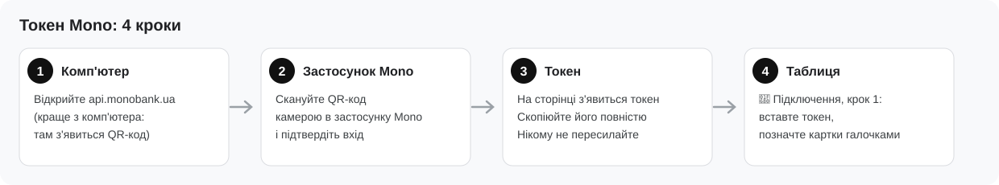
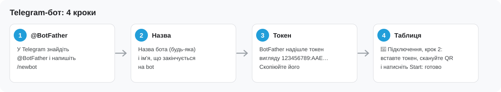

# Як користуватися Monitoring Budgets

Коротко: зробіть копію шаблону, відкрийте «🚀 Підключення» і пройдіть 4 кроки (картка, Telegram, регулярні, Gemini; будь-який можна пропустити), далі пишіть у «Журнал» (або підтверджуйте чернетки з банку). Решту рахують формули й скрипт.

## 1. Копія і старт (5 хвилин, на комп'ютері)

1. «Зробити копію» шаблону (посилання в README). Копія ваша: автор шаблону її не бачить.
2. Відкрийте копію → меню «📊 Monitoring Budgets → 🚀 Підключення». Google попросить дозволи: що саме і навіщо, див. [PRIVACY.md](../PRIVACY.md).
3. Праворуч відкриється панель. Угорі «Я сам / Сім'я» (для сім'ї впишіть імена). Далі 4 кроки, кожен можна пропустити:
   1. **Картка**: відкрийте api.monobank.ua, відскануйте QR застосунком monobank, вставте токен. Панель покаже ваші картки й рахунки: позначте потрібні. Вид картки й ліміт, рахунок ФОП, імпорт щодня ставляться самі. Лишається вказати групу ФОП (якщо є) і з якого числа дохід іде в наступний місяць. Без Mono: ПриватБанк для ФОП, виписка з папки або лише вид картки.
   2. **Telegram**: QR веде в @BotFather (/newbot), вставте токен бота, відскануйте QR «Відкрити бота» і натисніть Start: панель сама побачить і надішле перше повідомлення. Для сімейної групи: окремий QR.
   3. **Регулярні**: «Знайти в операціях» покаже повторювані платежі й доходи (Netflix 299 ₴ 12-го, оренда, зарплата); позначте потрібні, і вони стануть планами. Свій платіж: «Додати свій».
   4. **Gemini**: знімок на Диску й текст навички, щоб скопіювати.
4. «Готово» внизу панелі. Аркуш «Старт»: чекліст показує, що вже готово; нижче блок «🧩 Модулі» (так / ні). Панель можна відкрити знову будь-коли: там видно, що підключено, і «Інше» (відключити банк чи бота, календар, захист).

На телефоні меню скриптів немає (обмеження Google), але таблиця, журнал, формули й автокатегорія працюють. Налаштування робіть на комп'ютері один раз.

## 2. Токен Mono

- Токен особистий і лише для читання: ним не можна переказати гроші.
- Зберігається лише в налаштуваннях скрипта у вашому Google-акаунті, не в таблиці й не в копіях.
- У сім'ї кожен підключає свій Mono зі свого Google-акаунта (свій токен інші не бачать).
- Імпорт за розкладом: «🚀 Підключення», крок 1, «Імпорт з банку щодня» (о 12:45, 18:45 і 23:45); вмикається сам, коли підключаєте Mono.

## 3. Telegram-бот

- Окремий бот для кожної таблиці: так повідомлення не переплутаються.
- Сімейна група: у панелі «QR для сімейної групи», відскануйте й виберіть групу; панель сама побачить.
- QR у панелі малюються самим скриптом: посилання нікуди не відправляються.
- Модуль «📨 Telegram» на «Старті» вимикає всі повідомлення без видалення бота.

## 4. ПриватБанк для ФОП («Автоклієнт»)

«Приват24 для бізнесу» → Каталог послуг → Інтеграція (Автоклієнт) → підключити → токен. У таблиці: «🚀 Підключення», крок 1, «ПриватБанк для ФОП», токен і IBAN рахунків ФОП. Лише читання виписки: платежів код не створює.

Інші банки: збережіть виписку CSV (або Google Таблицю) в папку «Monitoring Budgets: виписки» на Диску й запустіть «📥 Імпорт виписок з папки».

## 5. Щодня

- Шапка «Журналу»: «Мої зараз», «На картці», три найгірші бюджети, наступний місяць, грейс. «Писати у рядок № … ↓» веде на рядок для вводу.
- Витрата готівкою чи без банку: рядок у «Журналі» (дата, сума, категорія, статус «✅ факт»). Дата й категорія часто ставляться самі.
- З банку приходять «🏦 чернетки»: перевірте категорію і поставте «✅ факт» (або «✅ Підтвердити чернетки з категорією» в меню).
- Разовий майбутній платіж: рядок зі статусом «план»: «Дні» й «Charts» покажуть прогноз.
- Регулярні платежі й доходи (оренда, підписки, зарплата): аркуш «Регулярні», рядок на кожен (категорія, сума, день, як часто). Плани до кінця наступного місяця скрипт ставить у журнал сам. Прийшов факт чи чернетка з банку тієї ж категорії (±5 днів, ±25 % суми): план місяця зникає сам; можна й просто поставити плану «✅ факт». Колонка «Стан» каже, що далі, і чи щось прострочено.
- «Charts»: фінанси зараз, залишок за 60 днів, цей місяць проти попереднього кварталу, групи й типи, «чорні діри», мої гроші, прогноз, ліміт. «Ліміт на місяць ✎» для «чорної діри» можна вписати просто там.
- На телефоні відкривайте «charts_mob»: те саме трьома вузькими стовпчиками, гортайте вбік.

## 6. Модулі (аркуш «Старт»)

| Модуль | Коли вмикати |
|---|---|
| 📨 Telegram | хочете ранковий підсумок і тривоги |
| 💳 Кредитний ліміт і грейс | кредитна картка з лімітом (Mono): «мої» окремо від ліміту, скільки внести до строку грейсу |
| 🤝 Борги й розстрочки | є розстрочка, позика чи вам винні |
| 💰 Бюджети категорій | ставите план на місяць у «Довіднику» (колонка F) |
| 📆 Календар платежів | хочете нагадування в Google Календарі |
| 💾 Копії й захист | майже завжди: нічна копія і захист формул |
| 🧾 ФОП | є ФОП у сім'ї |
| 🤖 Радник Gemini | хочете питати Gemini про свої фінанси |
| 🗂 Службові аркуші | треба поправити правила банку, рахунки, контрольну точку чи глянути «Перевірку» (типово «ні»: ці аркуші сховані, але працюють) |

## 7. Радник Gemini

1. Модуль «🤖 Радник Gemini» → «так». Знімок фінансів з'явиться на вашому Диску (папка «Monitoring Budgets: радник») і оновлюватиметься щодня.
2. Меню «🤖 Радник Gemini → 🤖 Як підключити навичку»: там кроки й текст для копіювання. Коротко: gemini.google.com → Skills → Create → Create manually (назва, опис, інструкції) або Upload файлу `gemini/monitoring-budgets-advisor/SKILL.md` з репозиторію.
3. У чаті Gemini: «/» і назва навички, потім питання: «Де ми переплачуємо за 3 місяці?», «Чи вистачить на подарунки в грудні?», «Скільки відкласти на податки ФОП?», «Які підписки скасувати?».

Рівень деталей знімка: «Налаштування», B23 (підсумки / категорії / операції без коментарів). Коментарів, номерів карток і токенів у знімку немає ніколи.

## 8. Оновлення

«🩺 Стан таблиці» показує, чи вийшла нова версія. Як оновитись: README, розділ «Як оновитись» (нова копія + «📦 Перенести дані зі старої копії»).

## Якщо щось не так

- «🩺 Стан таблиці»: версія, «Перевірка», копії, імпорт, Telegram, календар, модулі, радник.
- Аркуш «Перевірка» (службовий: «🗂 Службові аркуші» → «так»): що саме не сходиться і що зробити.
- Питання: [Issues](https://github.com/VladyYerys/monitoring-budgets/issues) репозиторію (без сум, токенів і особистих даних у тексті).

Це не фінансова й не податкова консультація.
